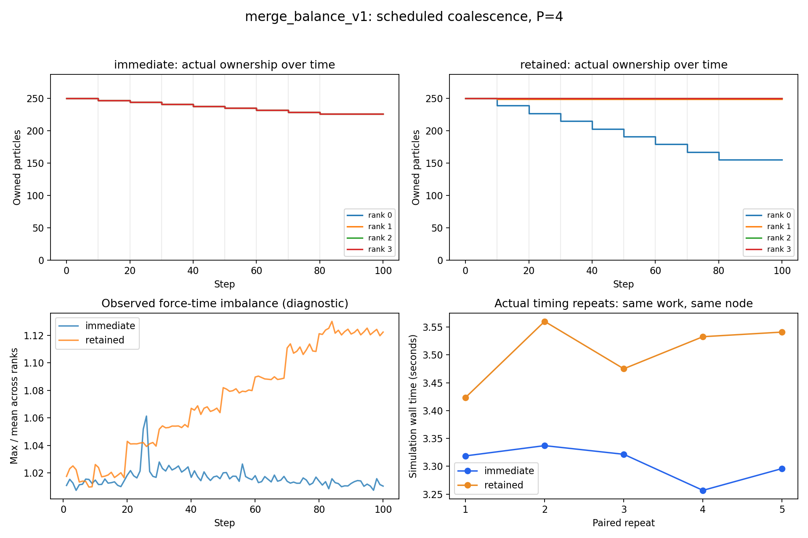

# Does redistributing particles after merging improve MPI performance?

**Result: immediate redistribution reduced mean runtime by 5.7%** compared with
retaining ownership, across five repeats on four MPI ranks on the same HPC node.
Both policies performed identical work and produced matching simulated states.



| Policy | Final particles per rank | Mean runtime | SD between runs |
|---|---|---:|---:|
| Immediate redistribution | 226, 226, 226, 226 | 3.306 s | 0.031 s |
| Retained ownership | 155, 249, 250, 250 | 3.506 s | 0.056 s |

## What we tested

Start with 1,000 Gaia particles and run 100 time steps. At steps 10,20,...,80,
merge 12 prescribed pairs, leaving 904 particles. The fixed particle-ID schedule
deliberately concentrates most losses on one initial owner. These are **synthetic
merge events**, not distance-based physical collisions.

Merged mass is summed; position and velocity are mass-weighted. The immediate
policy restores equal ownership after each event. The retained policy keeps
surviving owners, with a merged particle inheriting the smaller-ID particle's owner.
Both use the same serial force kernel and canonical summation order.

Both policies reconstruct the full merged state on every rank, so redistributing
ownership does not need a separate migration transfer. The result supports this
replicated-state design for uneven losses; it does not establish a universal policy
or reproducibility across nodes/days. Details: [results/REPORT.md](results/REPORT.md).

## Files

- **`code/`**: executed simulation/analysis code and `batch.sh` for a fresh HPC run.
- **`data/`**: exact input, merge schedule and small validation fixture.
- **`results/`**: figures, explanation and individual timing/diagnostic CSV rows.
- **`config.json`**: fixed parameters; **`manifest.json`**: file fingerprints.
- **`raw_evidence.zip`**: original job script/logs, validation, full traces, final
  states and original source manifest. Compressed to avoid hundreds of loose files.

## Reproduce on DTU HPC

Use a fresh clone/copy, enter its `experiments` directory, then submit one job:

```bash
cd /path/to/LSM-Project2/experiments
bsub < code/batch.sh
```

It reserves 24 slots on one node, starts four MPI ranks, validates both policies,
and runs five timing repeats per policy in the same seven-minute allocation.
Run order alternates. Check `bjobs -w` and `merge_balance_JOBID.out/.err`.
After completion, `jobs/p4/status.json` must say `"passed": true`.

Generate the new run's report:

```bash
module load pandas/2.3.0-python-3.12.11
module load matplotlib/3.10.3-numpy-2.3.1-python-3.12.11
python3 code/analyze.py
```

New output goes into ignored `jobs/` and `analysis/`; the supplied `results/` stays
unchanged. Existing run folders are refused, so use a fresh copy for another run.

## Regenerate the supplied results without rerunning MPI

In a fresh local copy of `experiments`, with NumPy/pandas/matplotlib available:

```bash
python -m zipfile -e raw_evidence.zip .
python code/analyze.py
```

This unpacks the original jobs and regenerates `analysis/REPORT.md` and its figures.
Do this in a separate copy from a fresh HPC run, because both use `jobs/`.

The earlier radius pilot was useful validation, but all its merges occurred at step
1; it motivated this repeated-event comparison. It and packaging backups are kept
locally in ignored `.local/`, not included in the Git upload. No original project
files outside `experiments/` have been changed.
