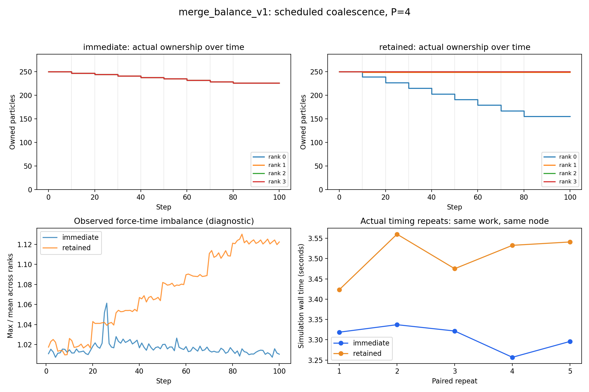
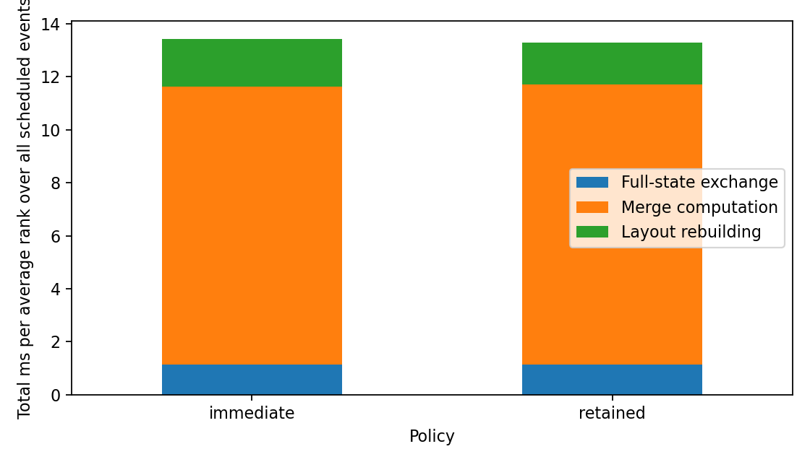

# merge_balance_v1: results

## Result

Both policies passed the same 8-event schedule, matching event checkpoint states and final states. Each timing run completed 100 steps and 89,548,512 interactions.

- **immediate:** [226, 226, 226, 226] particles per rank at the end.
- **retained:** [155, 249, 250, 250] particles per rank at the end.

The ratio mean(retained walltime) / mean(immediate walltime) is **1.0606**. The lower observed mean belongs to **immediate** in this allocation. Values above 1 favour immediate redistribution.

## Five timing repeats (or configured repeat count)

| Policy | Repeats | Mean walltime (s) | SD between runs (s) | Mean ms/step |
|---|---:|---:|---:|---:|
| immediate | 5 | 3.305994 | 0.031195 | 33.0599 |
| retained | 5 | 3.506450 | 0.056248 | 35.0645 |

[Each paired measurement](paired_comparison.csv). Mean paired time saved by immediate: 0.200457 s; sample SD of paired differences: 0.069934 s.

## Why the timings may differ

- immediate: mean force-time max/mean after the last event = 1.0118; theoretical work max/mean = 1.0000.
- retained: mean force-time max/mean after the last event = 1.1229; theoretical work max/mean = 1.1062.

The force work is proportional to owned_particles*(N-1). Equal blocks reduce the slowest rank's interaction count. MPI communication and synchronization include waiting for that slowest rank. Exchange time therefore does not measure pure network latency.

Both policies exchange the full state for each scheduled event and reconstruct it on every rank. Immediate redistribution changes ownership using this already replicated state; there is no extra Scatterv or dedicated migration transfer. Event-stage times are separate diagnostic measurements, summed per rank then averaged; they do not directly subtract from the uninstrumented timing repeats.

## Scope of the conclusion

This is a synthetic prescribed workload using Gaia initial positions, not naturally occurring stellar collisions. A schedule intentionally concentrated in one initial owner's block tests an unfavourable case for retained ownership. It does not establish how often this pattern occurs in natural simulations.

Both policies ran on n-62-21-77 in job 30001830; order alternated across repeats. Five launches within one allocation do not measure variation between nodes/days. If timing differences are small relative to run-to-run variation, repeat in a new allocation before claiming an improvement.

A distributed merge implementation could have different migration costs. The result applies to this replicated-state implementation and does not justify a universal load-balancing policy.

## Evidence

- [Frozen configuration](../config.json)
- [Fixed particle-ID schedule](../data/schedule.json)
- [Source and input hashes](../manifest.json)
- [Raw timing repeats](timing_runs.csv)
- [Per-step imbalance](diagnostic_steps.csv)
- [Merge events and ownership changes](merge_events.csv)
- [Event-stage timings](event_stage_mean_rank_ms.csv)
